<div align="center">


[下载最新版](https://github.com/luciferoho/inkbox/releases/latest) · [问题反馈](https://github.com/luciferoho/inkbox/issues) · [设计规范](./DESIGN.md)

</div>

***

## 简介

墨匣 Inkbox 是参考 Typora 使用体验、界面完全原创的桌面 Markdown 编辑器，基于 Electron + Vue 3 + TypeScript。

设计语言为原创的「**墨匣 · 纸面**」（Ink & Paper）：常驻左缘的深色**墨脊**导航 + 浮起的**纸卡**编辑面 + 暖纸底色与琥珀点睛。与 Typora 的"隐藏一切的白纸"不同，墨匣是"工作台上的纸卡"——功能入口常驻可见，写作时可一键收起。完整设计规范见 [DESIGN.md](./DESIGN.md)。

## 界面预览

以下截图均以内置的 [展示样张](./samples/展示样张.md) 实拍：

<table>
  <tr>
    <th width="50%">即显模式 · 亮色</th>
    <th width="50%">双栏模式 · 亮色（源码 ⇄ 预览同步）</th>
  </tr>
  <tr>
    <td align="center">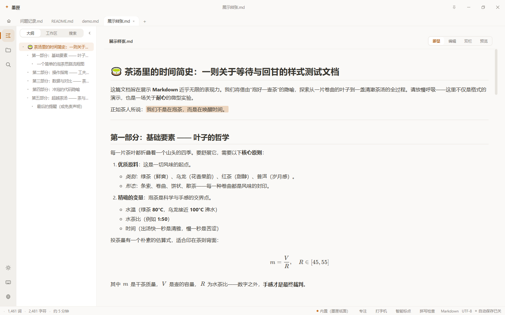</td>
    <td align="center">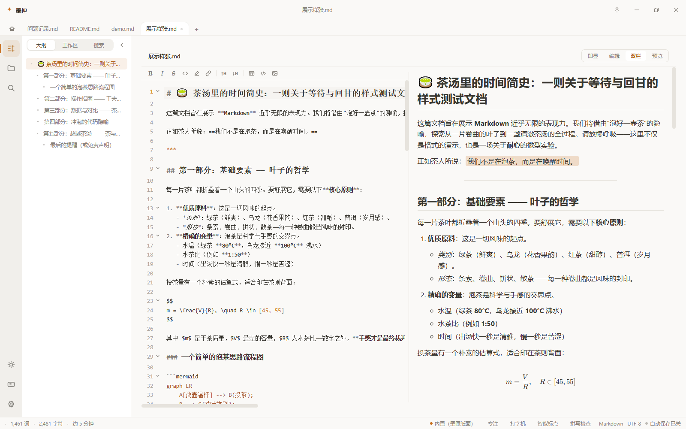</td>
  </tr>
  <tr>
    <th width="50%">即显模式 · 暗色</th>
    <th width="50%">预览模式 · 暗色</th>
  </tr>
  <tr>
    <td align="center">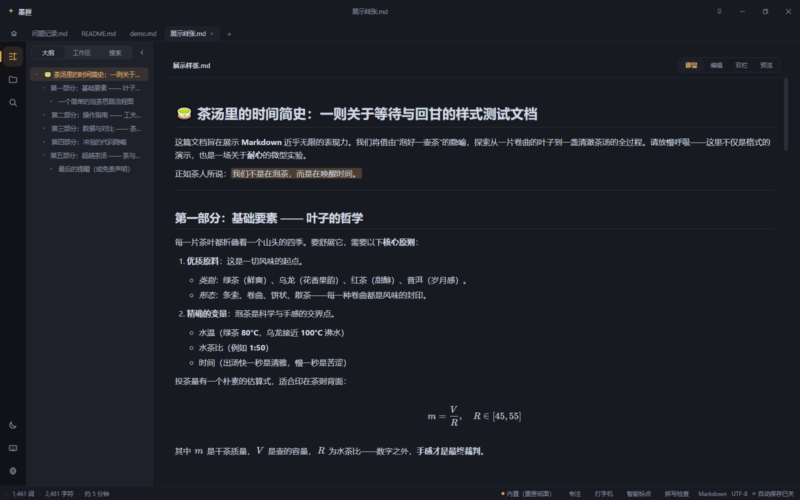</td>
    <td align="center">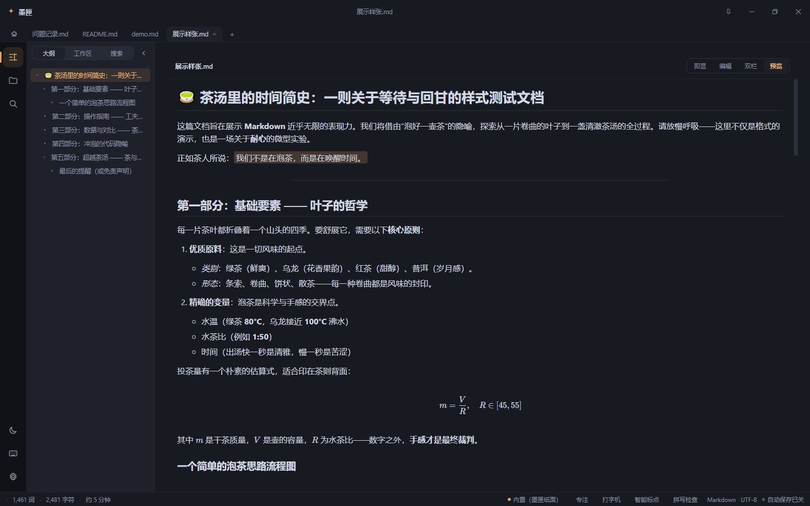</td>
  </tr>
</table>

## 兼容 Typora 主题

墨匣兼容主流 Typora 主题：将下载的主题放入主题目录（应用内 **设置 → 主题 → 打开主题目录**）即可在设置中切换，支持明暗变体跟随与多配色族。

| 主题              | 变体           | 官方地址                                                                                              | 下载                                                                                        |
| --------------- | ------------ | ------------------------------------------------------------------------------------------------- | ----------------------------------------------------------------------------------------- |
| phycat          | 11 种配色       | [sumruler/typora-theme-phycat](https://github.com/sumruler/typora-theme-phycat)                   | [前往下载](https://github.com/sumruler/typora-theme-phycat/releases)                          |
| esther-inspired | 浅色 / 深色      | [lisitan/esther-obsidian-typora-themes](https://github.com/lisitan/esther-obsidian-typora-themes) | [前往下载](https://github.com/lisitan/esther-obsidian-typora-themes/releases)                 |
| eyes-green      | 浅色 / 深色      | [aqimake/typora-eyes-green-theme](https://github.com/aqimake/typora-eyes-green-theme)             | [前往下载](https://github.com/aqimake/typora-eyes-green-theme/releases)                       |
| vue             | 浅色 / 深色      | [blinkfox/typora-vue-theme](https://github.com/blinkfox/typora-vue-theme)                         | [直接下载](https://codeload.github.com/blinkfox/typora-vue-theme/zip/master)                  |
| morandigarden   | 浅色           | [Kitsunee-CN/MorandiGarden](https://github.com/Kitsunee-CN/MorandiGarden)                         | [前往下载](https://github.com/Kitsunee-CN/MorandiGarden/releases)                             |
| orangeheart     | 浅色           | [evgo2017/typora-theme-orange-heart](https://github.com/evgo2017/typora-theme-orange-heart)       | [前往下载](https://github.com/evgo2017/typora-theme-orange-heart/blob/master/orangeheart.css) |
| kiro            | 深色           | [mooonu/typora-kiro-theme](https://github.com/mooonu/typora-kiro-theme)                           | [前往下载](https://github.com/mooonu/typora-kiro-theme/releases)                              |
| sonnet          | 浅色 / 深色      | —                                                                                                 | [直接下载](https://codeload.github.com/bexino/sonnet/zip/refs/heads/main)                     |
| claude-like     | 浅色 / 深色 / 灰色 | [Muyiiiii/Typora_Claude-Like_Theme](https://github.com/Muyiiiii/Typora_Claude-Like_Theme)         | [前往下载](https://github.com/Muyiiiii/Typora_Claude-Like_Theme/releases)                     |
| lightmind       | 浅色 / 深色      | [SunMoonTrain/LightMindTheme](https://github.com/SunMoonTrain/LightMindTheme)                     | [前往下载](https://github.com/SunMoonTrain/LightMindTheme/releases)                           |

以下主题截图均以内置的 [展示样张](./samples/展示样张.md) 实拍（即显模式 + 大纲侧栏）：

<table>
  <tr>
    <td width="50%" align="center"><strong>phycat</strong> · caramel（亮）<br />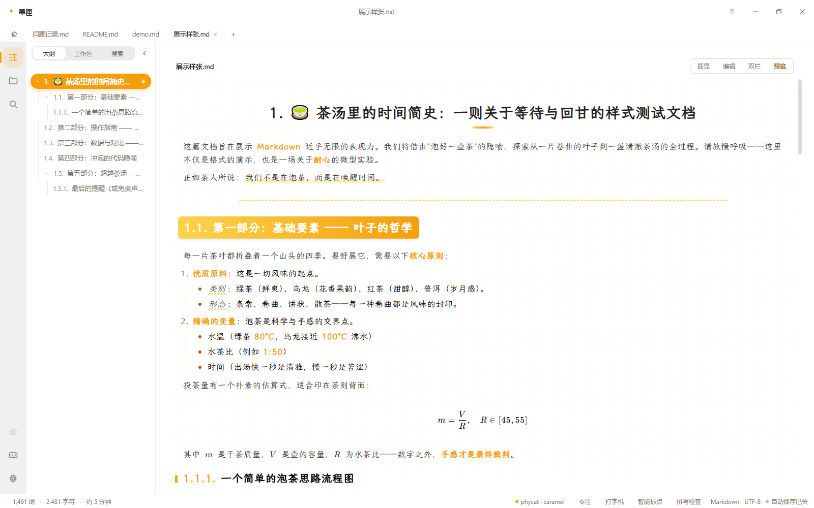</td>
    <td width="50%" align="center"><strong>phycat</strong> · vampire（暗）<br />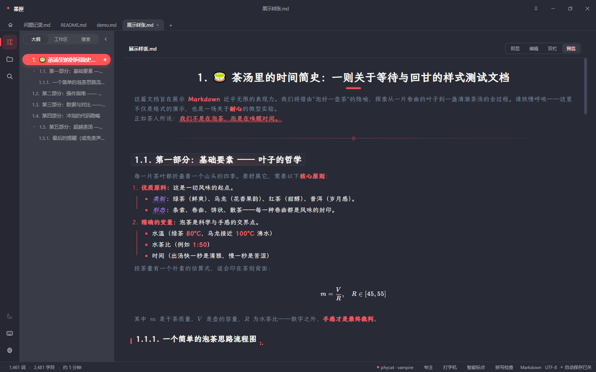</td>
  </tr>
  <tr>
    <td width="50%" align="center"><strong>esther-inspired</strong> · 浅色<br />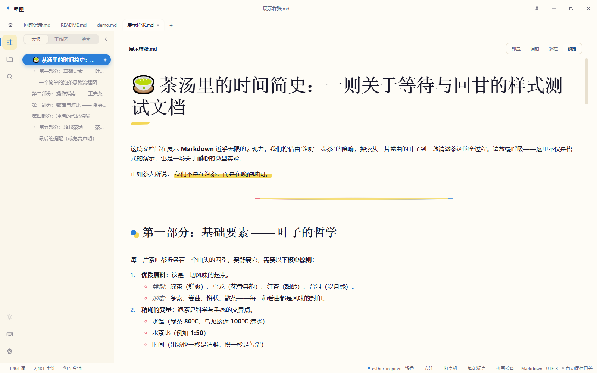</td>
    <td width="50%" align="center"><strong>esther-inspired</strong> · 深色<br /></td>
  </tr>
  <tr>
    <td width="50%" align="center"><strong>eyes-green</strong> · 浅色<br />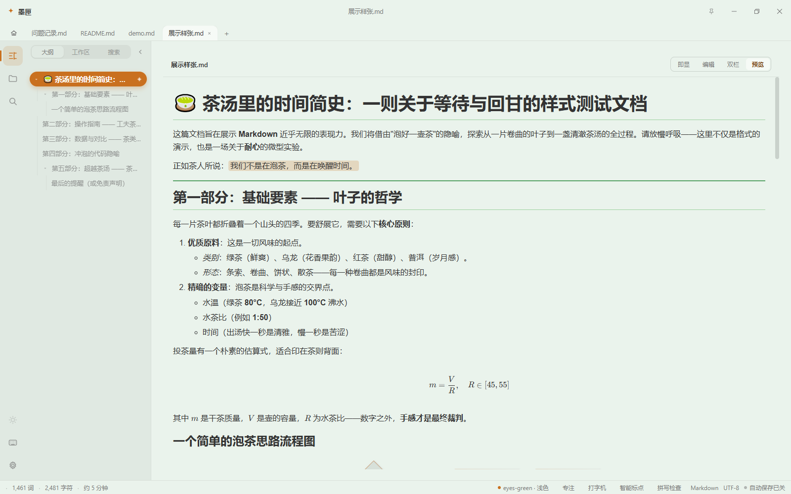</td>
    <td width="50%" align="center"><strong>eyes-green</strong> · 深色<br />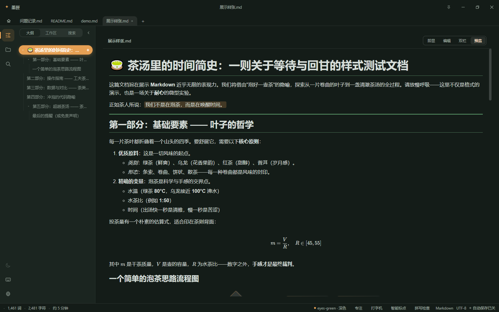</td>
  </tr>
  <tr>
    <td width="50%" align="center"><strong>vue</strong> · 浅色<br />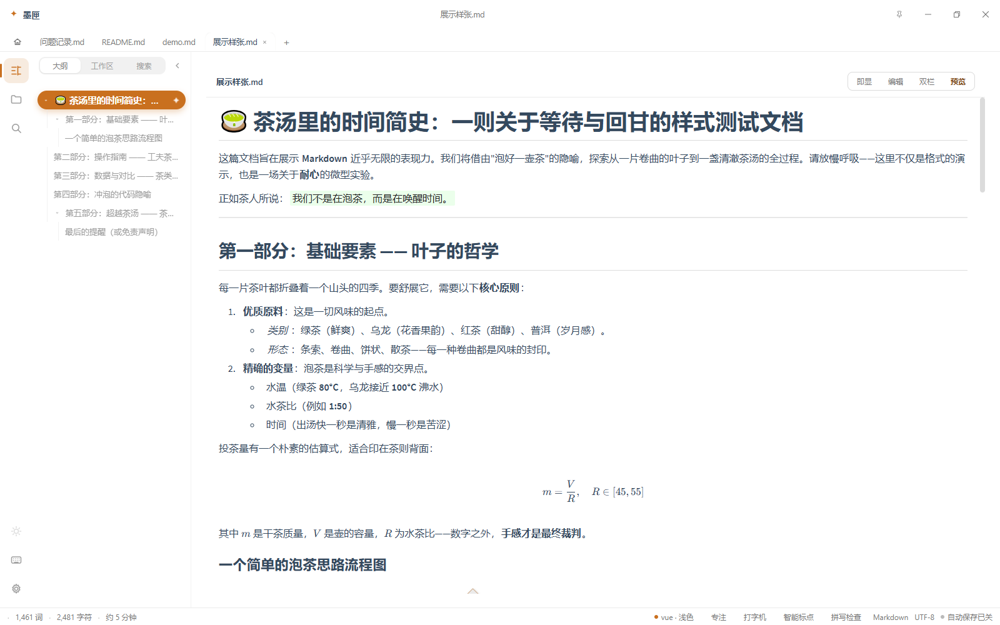</td>
    <td width="50%" align="center"><strong>vue</strong> · 深色<br />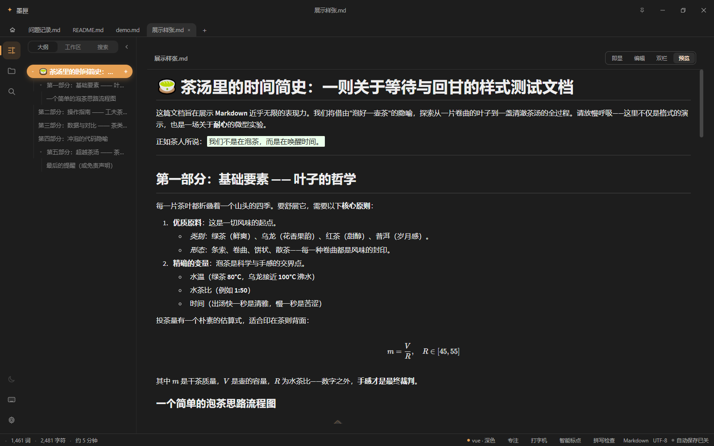</td>
  </tr>
  <tr>
    <td width="50%" align="center"><strong>sonnet</strong> · 浅色<br />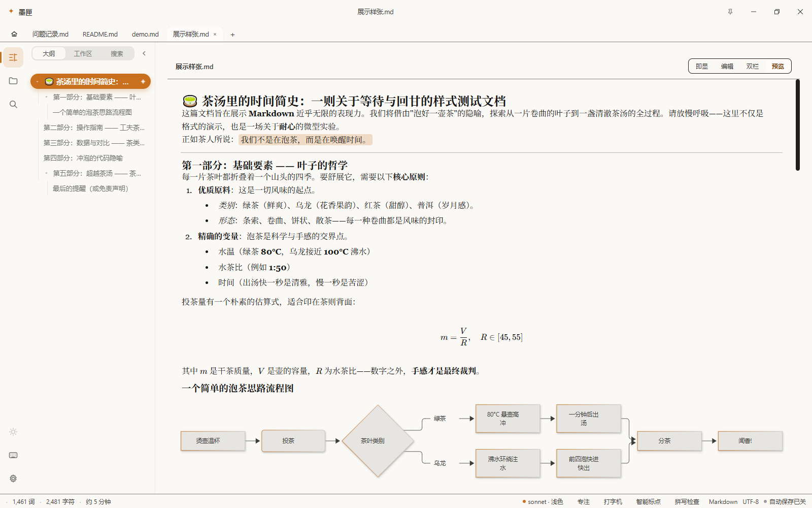</td>
    <td width="50%" align="center"><strong>sonnet</strong> · 深色<br />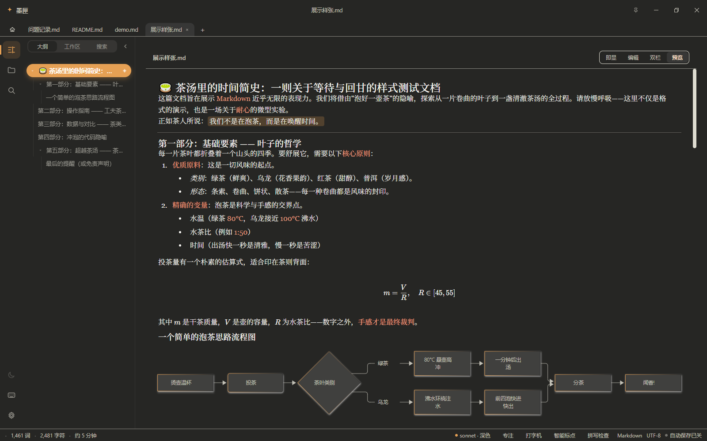</td>
  </tr>
  <tr>
    <td width="50%" align="center"><strong>claude-like</strong> · 浅色<br />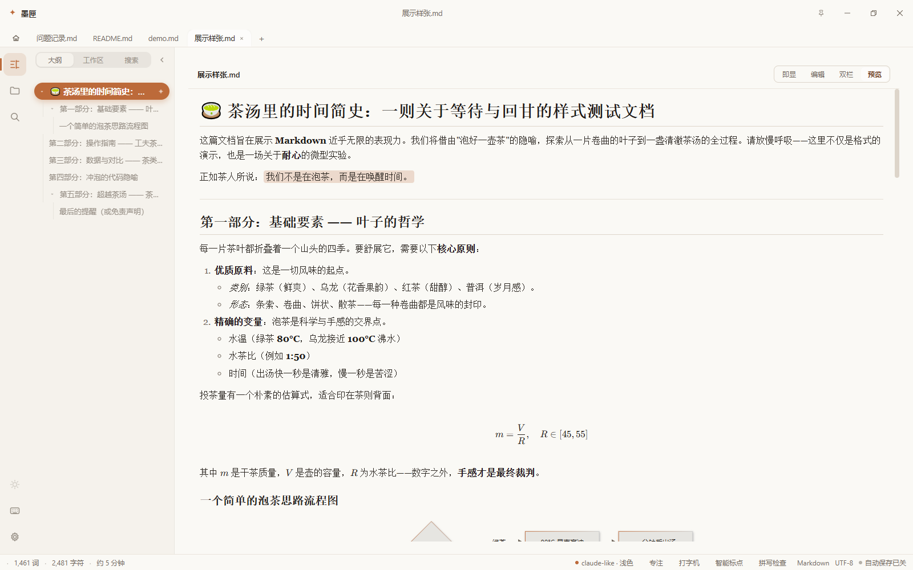</td>
    <td width="50%" align="center"><strong>claude-like</strong> · 深色<br />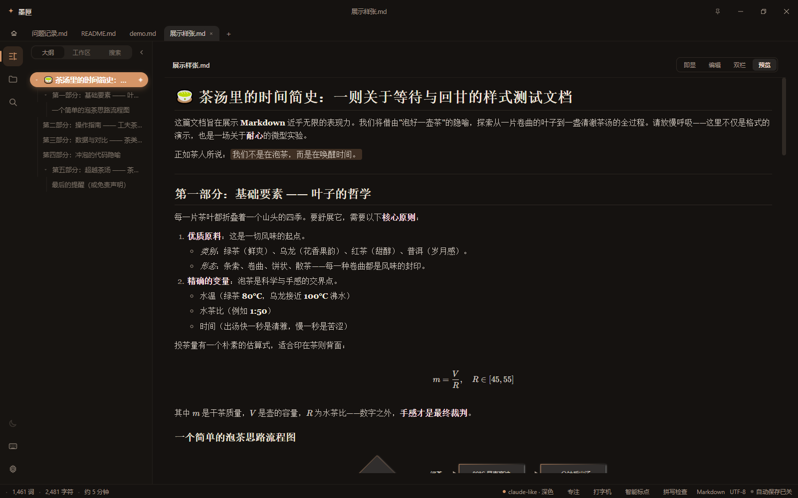</td>
  </tr>
  <tr>
    <td width="50%" align="center"><strong>lightmind</strong> · 浅色<br />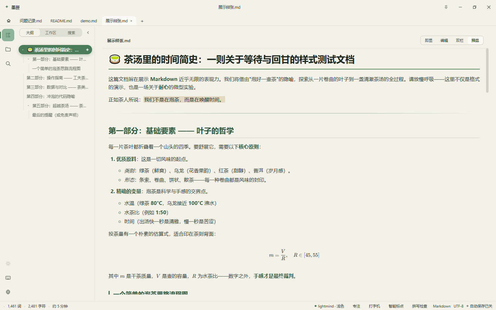</td>
    <td width="50%" align="center"><strong>lightmind</strong> · 深色<br />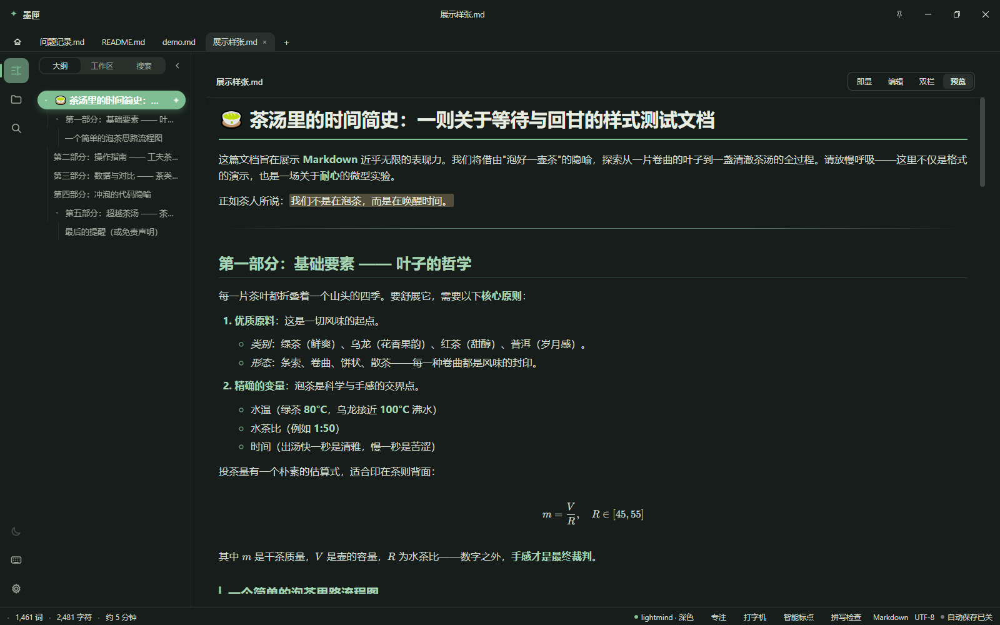</td>
  </tr>
</table>

<table>
  <tr>
    <td width="33.3%" align="center"><strong>morandigarden</strong><br />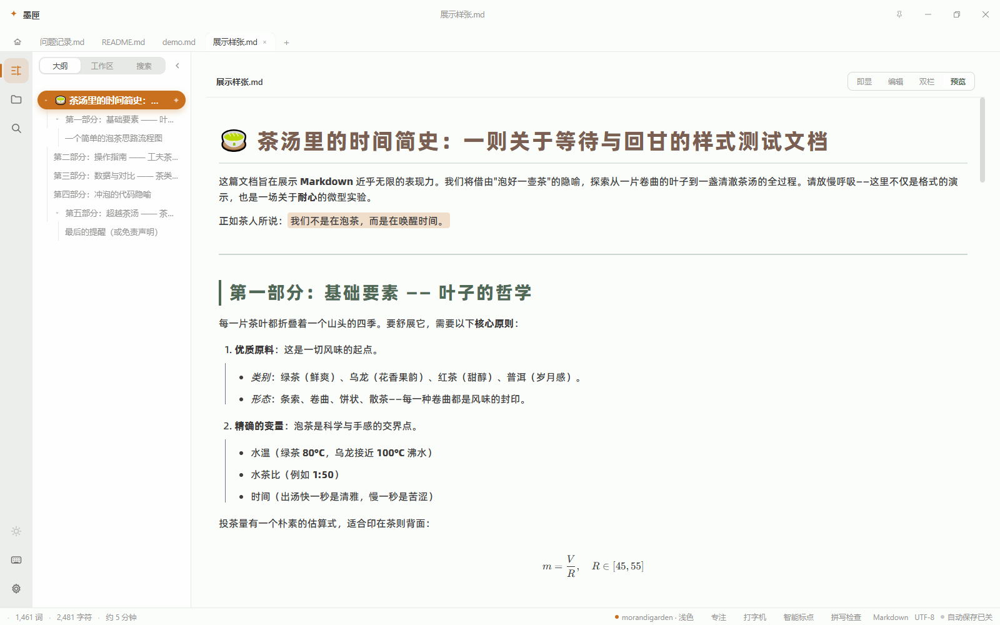</td>
    <td width="33.3%" align="center"><strong>orangeheart</strong><br />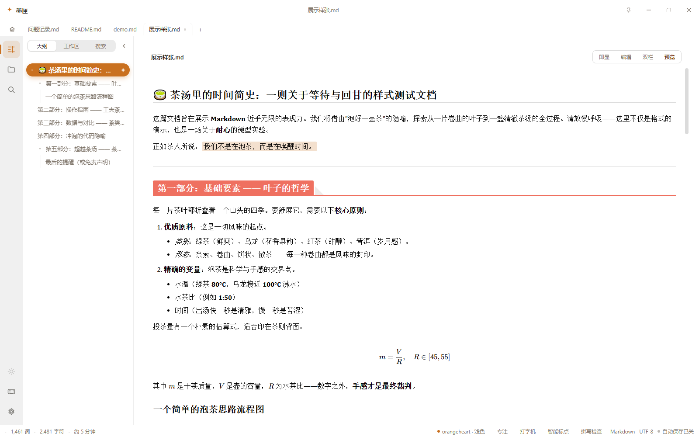</td>
    <td width="33.4%" align="center"><strong>kiro</strong><br /></td>
  </tr>
</table>

## 功能特性

**编辑器**

- 四种编辑模式：即显（所见即所得）/ 源码 / 双栏 / 预览，一键切换
- Vim 模式（源码与双栏）、打字机模式、专注模式
- 列表智能续行、退格删标记、块工具栏、表格可视化编辑、emoji 短代码
- 三种模式统一的查找替换（正则、大小写、整词）
- 应用级快捷键自定义 + 快捷键面板

**渲染**

- 数学公式（KaTeX 懒加载）、Mermaid 图表（主题跟随）、代码高亮
- 任务列表、多级标题大纲、图片点击放大查看器
- 双栏模式块级同步滚动

**效率**

- 全局搜索（工作区全文）、多标签、禅模式
- 文件树管理（新建/重命名/删除）、最近文件
- 本地图片：粘贴/拖拽自动落盘到文档旁 assets 目录
- PicGo 图床上传（可开关，失败回退本地）
- 自动保存、异常退出内容恢复

**导出**

- PDF / HTML / PNG / LaTeX
- PDF 页脚页码、横纵向、页边距可调；导出前实时预览

**插件**

- 插件系统：注册命令（可绑快捷键）、读取/替换当前文档
- 内置排版插件：盘古之白、标题平移、表格格式化、前置元数据（Front-Matter）

**窗口与系统**

- 多窗口、跨窗口标签拖拽、跨窗口文件去重
- 窗口置顶（标题栏图钉）、会话恢复（标签 + 文件夹）、崩溃自动恢复
- 托盘与关闭行为设置（退出 / 最小化到托盘）、开机自启、单实例
- 中英双语界面、应用内自动更新

## 下载安装

前往 [Releases](https://github.com/luciferoho/inkbox/releases/latest) 下载：

| 文件                         | 说明                    |
| -------------------------- | --------------------- |
| `Inkbox-<版本>-setup.exe`    | 安装版（推荐，可选安装目录，支持自动更新） |
| `Inkbox-<版本>-portable.exe` | 便携版（免安装单文件）           |

- 系统要求：Windows 10 及以上（x64）
- 安装包未做代码签名，首次运行如遇 SmartScreen 提示，选择「更多信息 → 仍要运行」即可

## 快捷键（节选）

| 快捷键                           | 功能           |
| ----------------------------- | ------------ |
| `Ctrl+N` / `Ctrl+S`           | 新建 / 保存      |
| `Ctrl+F` / `Ctrl+H`           | 查找 / 替换      |
| `Ctrl+E`                      | 导出           |
| `Ctrl+,`                      | 偏好设置         |
| `Ctrl+Tab` / `Ctrl+Shift+Tab` | 切换标签         |
| `F8` / `F9`                   | 专注模式 / 打字机模式 |
| `Ctrl+\`                      | 切换编辑模式       |

完整列表见应用内 **快捷键** 面板（支持自定义改键）。

## 从源码构建

```bash
git clone https://github.com/luciferoho/inkbox.git
cd inkbox
npm install          # Electron 二进制未自动下载时：node node_modules/electron/install.js
npm run dev          # 开发模式（HMR）
npm run typecheck    # 类型检查（主进程 + 渲染进程）
npm run dist         # 打包：NSIS 安装版 + 便携版（release/pkg/）
```

- Electron 与 NSIS 二进制默认走 npmmirror 镜像（`.npmrc` 与 `electron-builder.yml`）
- 应用图标由 `scripts/make-icon.mjs` 程序化绘制，改设计后执行 `npm run icons` 重新生成

## 插件开发

插件是含 `plugin.json` 与 `main.js` 的文件夹，放入插件目录即可被发现（设置 → 插件 → 重新加载）。内置插件见 [`builtin-plugins/`](./builtin-plugins)，可作为模板参考。

## 项目结构

```
├─ src/main/               主进程：窗口、菜单、托盘、IPC、文件监视、会话、更新
│  └─ ipc/                 IPC 处理器（config / fs / export / search / plugins …）
├─ src/preload/            预载脚本：contextBridge 类型化 API 白名单
├─ src/renderer/           渲染进程（Vue 3）
│  ├─ components/          编辑器 / 侧栏 / 弹层组件
│  ├─ editor/              CodeMirror 与 ProseMirror 集成
│  ├─ services/            markdown 渲染管线、导出、插件宿主
│  └─ stores/              Pinia 状态（文档 / 界面 / 工作区）
├─ src/shared/             主/渲染共享类型与快捷键注册表
├─ builtin-plugins/        内置排版插件
├─ samples/                功能示例文档
├─ scripts/                构建辅助脚本（图标绘制）
└─ DESIGN.md               界面设计规范
```

## 技术栈

Electron · Vue 3 · Pinia · TypeScript · CodeMirror 6 · Milkdown (ProseMirror) · markdown-it · KaTeX · Mermaid · highlight.js · Turndown · electron-updater

## 许可证

[MIT](./LICENSE) © [Lucifer](https://github.com/luciferoho)
