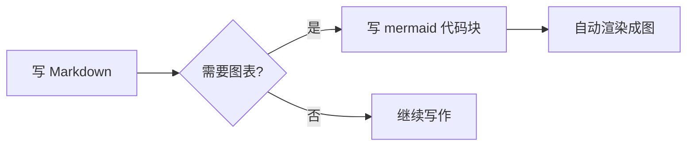
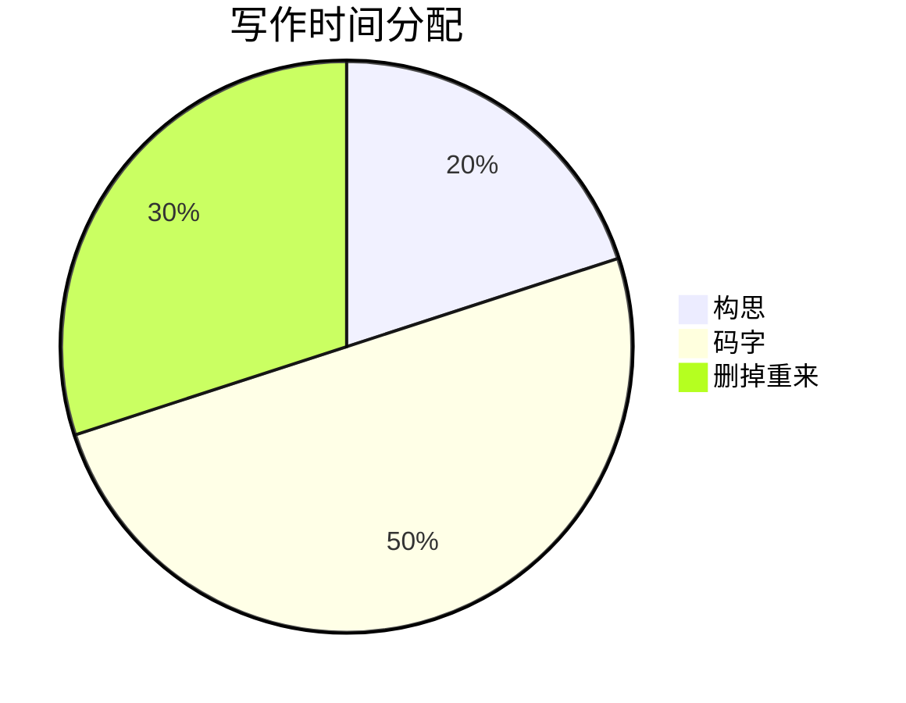

# Markdown 语法手册

欢迎使用墨匣！这份手册覆盖墨匣支持的全部 Markdown 语法：标准 Markdown、GFM 扩展，以及墨匣额外支持的高亮、上下标、脚注、公式、图表、emoji、警告块等。

**本文档本身就是一份活示例**——切到「双栏」或「编辑」模式可以同时看到每种语法的写法与效果；「即显」「预览」则是最终阅读效果。动手改一改，所见即所得。

[TOC]

## 标题

行首 1~6 个 `#` 加一个空格，对应一至六级标题：

### 这是三级标题

#### 这是四级标题

##### 这是五级标题

多级标题会自动进入左侧大纲与 [TOC] 目录，点击可跳转。

## 段落与换行

空一行开始新段落；段内直接回车即换行（与 Typora 一致）：
这一行用了段内换行，
所以和上一句还在同一个段落里。

## 字体样式

| 写法 | 效果 |
| --- | --- |
| `**粗体**` | **粗体** |
| `*斜体*` | *斜体* |
| `***粗斜体***` | ***粗斜体*** |
| `~~删除线~~` | ~~删除线~~ |
| `==高亮==` | ==高亮== |
| `X^2^` | X^2^ 上标 |
| `H~2~O` | H~2~O 下标 |
| `` `行内代码` `` | `const x = 1` |

## 引用

> 这是一段引用。行首加 `>` 即可。
>
> > 引用可以嵌套，多层 `>>` 更深入。
>
> 引用里也能用其他语法：**粗体**、`代码`、[链接](https://github.com)。

## 列表

无序列表用 `-`、`*` 或 `+`：

- 第一项
- 第二项
  - 缩进两个空格变成嵌套
    - 可以继续嵌套
- 第三项

有序列表用 `数字.`，渲染时编号自动归一：

1. 第一步
2. 第二步
   1. 子步骤
3. 第三步

任务列表用 `- [ ]`（未完成）与 `- [x]`（已完成），可以直接点击勾选：

- [x] 支持 GFM 基础语法
- [x] 支持公式、图表与脚注
- [ ] 正在写的下一篇文章

## 代码

行内代码用反引号包住：`npm install`、`Ctrl+C`。

代码块用三个反引号开始和结束，首行标注语言可获得语法高亮：

```ts
// TypeScript 示例
interface User {
  name: string
  age: number
}

function greet(user: User): string {
  return `你好，${user.name}！`
}
```

```python
# Python 示例
def fib(n):
    a, b = 0, 1
    while a < n:
        yield a
        a, b = b, a + b
```

不标注语言的代码块则保持素色排版。

## 分隔线

三个以上的 `-`、`*` 或 `_`（独占一行，前后空行）：

---

## 链接与图片

链接：[墨匣 Inkbox](https://github.com/luciferoho/inkbox)，也可以直接贴网址：https://github.com

图片语法与链接类似，前面多一个 `!`：

```text


```

在墨匣里更常用的方式：**直接粘贴截图**或拖入图片文件，会自动保存到文档同级的 `.assets` 目录并插入链接（开启图床后先上传图床）。`|400x300|` 修饰符可以限定显示尺寸。

## 表格

用 `|` 分列、`---` 分隔表头；冒号位置控制对齐：

| 默认 | 左对齐 | 居中 | 右对齐 |
| --- | :--- | :---: | ---: |
| 单元格 | 单元格 | 单元格 | 1.00 |
| 单元格 | 单元格 | 单元格 | 22.00 |

## 脚注

在正文里插入 `[^1]` 样式的标记，文档任意位置给出定义，点击角标可来回跳转[^1]。

也支持命名式写法[^note]。

[^1]: 这是脚注的内容。
[^note]: 命名只是便于书写，显示时仍按出现顺序编号。

## 数学公式（KaTeX）

行内公式用 `$` 包住：质能方程 $E = mc^2$，求和 $\sum_{i=1}^{n} i = \frac{n(n+1)}{2}$。

块级公式独占一段，用 `$$` 包住：

$$
\int_a^b f(x)\,dx = F(b) - F(a)
$$

## 图表（Mermaid）

用 ` ```mermaid ` 代码块即可建图（预览/即显中点击图表可回到源码编辑）：





## Emoji 表情

输入冒号短代码（`:单词:`）会自动补全并转换成字符，预览与即显直接显示效果：

```text
:smile:  :rocket:  :100:  :star:  :heart:  :tangerine:
```

效果：😄 🚀 💯 ⭐ ❤️ 🍊

## 目录

在文档任意位置单独一行输入 `[TOC]`，就会在此处生成可点击目录（即显与预览模式）。本手册开头就有一个。

## Front Matter 元信息

文档**最开头**（第一行起）用 `---` 包住的 YAML 会渲染成元信息块，不参与正文：

```yaml
---
title: 我的文章标题
date: 2026-10-27
tags: [随笔, 技术]
---
```

## 内联 HTML（白名单）

少量展示型标签可直接使用：`<u>` 下划线、`<mark>` 荧光、`<kbd>` 键帽、`<br>` 换行。

<u>下划线文字</u>、<mark>荧光笔标记</mark>、按 <kbd>Ctrl</kbd> + <kbd>P</kbd> 快速打开文件。

其余 HTML 会被当作普通文本转义显示——这是有意为之的安全设计。

## 警告块

GitHub 风格的警告块，支持五种类型：

> [!NOTE]
> 提示（Note）：补充说明信息。

> [!TIP]
> 技巧（Tip）：让写作更顺手的建议。

> [!IMPORTANT]
> 重要（Important）：必须了解的关键信息。

> [!WARNING]
> 警告（Warning）：可能出错的操作。

> [!CAUTION]
> 危险（Caution）：可能造成严重后果的操作。

## 转义字符

语法符号想原样显示时，在前面加反斜杠 `\`（行首的语法字符才需要转义）：

\# 这不是标题

\*这不是斜体\*

1\. 这不是列表

## 继续探索

- **本手册**：随时从主页按钮或 `F1` 重新打开（改键后在设置里可查）
- **主页的「功能示例」按钮**：四模式、图片、导出等完整功能之旅（关闭全部标签即可回到主页）
- **`Ctrl + /`**：快捷键速查面板（墨脊火箭图标也可打开；改键在应用设置里）
- **墨脊最下方的齿轮图标**：应用设置——主题、字体、图床、拼写检查、快捷键自定义
