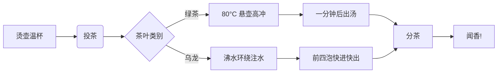

# 🍵 茶汤里的时间简史：一则关于等待与回甘的样式测试文档

这篇文档旨在展示 **Markdown** 近乎无限的表现力。我们将借由"泡好一壶茶"的隐喻，探索从一片卷曲的叶子到一盏清澈茶汤的全过程。请放慢呼吸——这里不仅是格式的演示，也是一场关于**耐心**的微型实验。

正如茶人所说：==我们不是在泡茶，而是在唤醒时间。==

---

## 第一部分：基础要素 —— 叶子的哲学

每一片茶叶都折叠着一个山头的四季。要舒展它，需要以下**核心原则**：

1.  **优质原料**：这是一切风味的起点。
    *   *类别*：绿茶（鲜爽）、乌龙（花香果韵）、红茶（甜醇）、普洱（岁月感）。
    *   *形态*：条索、卷曲、饼状、散茶——每一种卷曲都是风味的封印。
2.  **精确的变量**：泡茶是科学与手感的交界点。
    *   水温（绿茶 **80°C**，乌龙接近 **100°C** 沸水）
    *   水茶比（例如 **1:50**）
    *   时间（出汤快一秒是清雅，慢一秒是苦涩）

投茶量有一个朴素的估算式，适合印在茶则背面：

$$
m = \frac{V}{R}, \quad R \in [45, 55]
$$

其中 $m$ 是干茶质量，$V$ 是壶的容量，$R$ 为水茶比——数字之外，**手感才是最终裁判**。

### 一个简单的泡茶思路流程图



## 第二部分：操作指南 —— 工夫茶的仪式感

以下是一段经典的**潮州工夫茶**流程，它体现了秩序与即兴的结合：

1.  **备器**：孟臣壶、若琛杯，一只茶海，烧水器一应俱全。
2.  **温润**：沸水烫壶烫杯，顺手把茶宠浇得油光水亮。
3.  **醒茶**：
    - 第一泡注水后立即倒掉，唤醒沉睡的叶片。
    - 观察叶底舒展的速度，判断火功与陈化。
        - ✅ 理想：叶片边缘渐次展开，汤色透亮。
        - ❌ 失误：汤色浑浊发暗，多半是存放不当或火功过头。
4.  **出汤**：前四泡 **快进快出**，之后每泡顺延五秒，直到茶味淡成一阵回甘。

> **技术注记**：快出汤的本质是控制浸出物浓度曲线——前段取香，中段取味，尾段取韵。这是**科学**的部分。而每一泡之间等待的那十几秒，盯着袅袅的热气放空自己，则是**艺术**的开始。

## 第三部分：数据与对比 —— 茶类的理性选择

六大茶类性格迥异，下表对比了四种代表茶的处理方式：

| 茶类                     | 发酵程度   | 核心工艺         | 上手难度 | 适合场景             |
| :----------------------- | :--------- | :--------------- | :------- | :------------------- |
| **绿茶**（龙井）         | 不发酵 ⭐  | 杀青、理条       | ⭐⭐      | 春日午后、配青团     |
| **乌龙**（凤凰单丛[^1]） | 半发酵     | 做青、炭焙       | ⭐⭐⭐⭐   | 深夜码字、闻香止饿   |
| **红茶**（正山小种）     | 全发酵     | 萎凋、发酵、烘焙 | ⭐⭐      | 冬日手边、加奶无压力 |
| **普洱**（老生普）       | 后发酵     | 晒青、紧压、陈化 | ⭐⭐⭐     | 有耐心的朋友来访     |

周末茶会的筹备清单，欢迎勾选：

- [x] 选定主题茶单（一绿一乌一红）
- [x] 备好山泉水与备用滤网
- [ ] 练习一手稳定的「关公巡城」
- [ ] 说服朋友不要往单丛里加糖

## 第四部分：冲泡的代码隐喻

泡茶本质上是一个受控的萃取过程。我们可以用一段代码来抽象这一逻辑：

```python
# tea_brewing.py
class GongfuSession:
    def __init__(self, tea, water=100, ratio=50):
        self.tea = tea        # 茶叶对象（含类别、焙火属性）
        self.water = water    # 水温
        self.ratio = ratio    # 水茶比
        self.steep = 0        # 当前冲泡次数
        self.aroma = 0.0      # 香气浓度

    def brew(self):
        """执行一次冲泡的核心算法"""
        temp = self._adjust_temp()        # 按茶类修正水温
        self.steep += 1

        if self._is_wake_up(self.steep):  # 醒茶不喝
            return "🚮 倒掉，唤醒茶叶。"

        self.aroma = self._measure_aroma(temp)
        if self.aroma >= 0.8:
            return "🌸 高香！这一泡值回票价。"
        elif self.aroma >= 0.5:
            return "🍵 顺口，适合配茶点慢慢聊。"
        else:
            return "💧 淡了，水温或时间该加把劲。"

# 开席
tonight = GongfuSession(tea="凤凰单丛 鸭屎香", ratio=45)
print(tonight.brew())
```

## 第五部分：超越茶汤 —— 茶与生活

一壶好茶的影响，远不止于味蕾。

*   **它是节奏的调节器**：烧水、注水、出汤的几分钟里，手机被自然地放到了视线之外。
*   **它是待客的分寸**：「我给你泡个茶」是中国式客厅里最松弛的挽留。
*   **它是灵感的引信**：多少方案在第三泡之后突然清晰，多少分歧在续水时悄悄和解。

<p class="page-break"/>

---

### 最后的提醒（或免责声明）

> ⚠️ **请注意**：本文档中关于茶的所有描述，都源于作者的主观体验与有限的茶叶预算。茶的**终极奥义**在于你的个人偏好。如果你爱喝冰红茶、茉莉奶绿，或者就爱嚼茶叶解腻，那也完全正确。所有关于"讲究"的探讨，其目的都是为了**增进饮茶的乐趣，而非设立品味的藩篱**。

> [!TIP]  
> 绿茶怕烫，水烧开了晾三分钟再冲，鲜爽感立省一半学费。

> [!WARNING]  
> 空腹猛灌浓茶，容易出现"茶醉"——心慌手抖，比咖啡因来得更温柔也更突然。

> [!NOTE]  
> 好水不抢戏：纯净水泡茶最稳，矿物质的浓淡会明显改写同一泡茶的性格。

> [!IMPORTANT]  
> **隔夜茶不喝，头道茶醒茶**——这两条是老茶客间少有的、没有争议的共识。

[^1]: 单丛的香型多到离谱（蜜兰香、鸭屎香、芝兰香……），相传有"一树一香"之说，点茶前建议先问香型。
